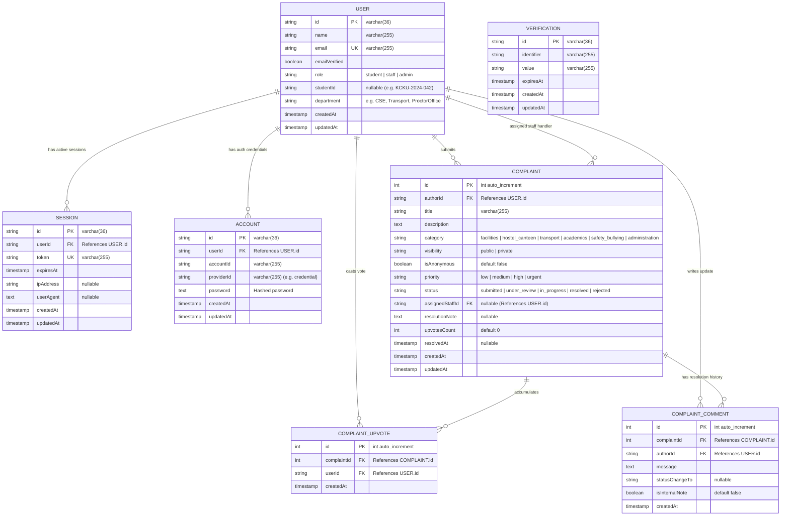
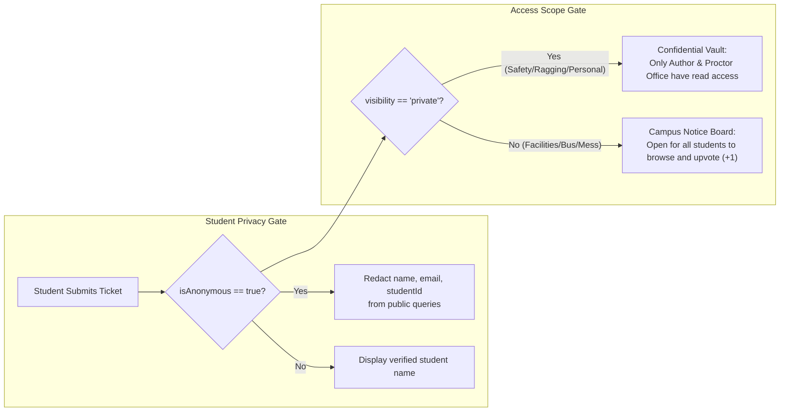

# 🏛️ CampusFix — Architectural Plan & System Design

**Institution:** Kauwar Chor Kindergarten University (KCKU)  
**System:** Fullstack Campus Complaint, Grievance & Student Welfare Resolution Portal  
**Backend:** NestJS 12 (REST API, Simplified Architecture)  
**Authentication:** Better Auth 1.7 (Drizzle MySQL Adapter, Session Cookies, RBAC)  
**Database:** MySQL + Drizzle ORM (Multi-Folder Schema)  
**Frontend:** Pure Astro 5 (Zero-JS Runtime, Y2K Neobrutalist UI)

---

## 1. 📊 Entity-Relationship Diagram (ERD)



---

## 2. 📁 Multi-Folder Drizzle Schema Architecture

Following the official [Drizzle ORM Multi-file Schema Declaration](https://orm.drizzle.team/docs/sql-schema-declaration):

```text
backend/src/database/schema/
├── auth.schema.ts        # user, session, account, verification (Better Auth Tables)
├── complaints.schema.ts  # complaints table, categories & statuses enum
├── upvotes.schema.ts     # complaint_upvotes (unique constraint: complaintId + userId)
├── comments.schema.ts    # complaint_comments (timeline updates & resolution log)
├── relations.ts          # Relational bindings across users, complaints, upvotes & comments
└── index.ts              # Barrel export consumed by drizzle.config.ts & DatabaseModule
```

---

## 3. 🛡️ Student Privacy & Security Gate



---

## 4. 🗺️ Unified End-to-End User Flow

```mermaid
flowchart TD
    %% Student Journey
    subgraph StudentFlow ["🎓 1. Student Portal Flow"]
        Start(["Student Enters CampusFix"]) --> Browse["Browse Campus Notice Board<br/>(Filter by Category / Search)"]
        Browse --> CheckIssue{"Is the issue already reported?"}

        CheckIssue -- "Yes (Common Issue)" --> Upvote["Click '👍 Me Too (+1)'<br/>Increases urgency counter on Public Board"]
        CheckIssue -- "No (New Issue)" --> SelectType{"Select Complaint Type"}

        SelectType -- "📢 Public Issue<br/>(Facilities, Mess, Bus, Exams)" --> PubForm["Fill Public Ticket Form<br/>• Title & Description<br/>• Category Selection<br/>• Optional Anonymous Toggle"]
        SelectType -- "🔒 Confidential Report<br/>(Ragging, Bullying, Safety, Harassment)" --> PrivForm["Fill Sealed Grievance Form<br/>• Auto-Sealed from Public Board<br/>• Anonymous Identity Masking<br/>• Routed Only to Proctorial Body"]

        PubForm --> Submit["Submit to NestJS Backend"]
        PrivForm --> Submit
    end

    %% Backend Triage & Security
    subgraph BackendTriage ["🛡️ 2. Security Filter & Triage (BUProctor Office)"]
        Submit --> PrivacyCheck{"Privacy & Identity Gate"}
        PrivacyCheck -- "Anonymous = True" --> Mask["Strip Name & Student ID<br/>(Author Identity Sealed in Encrypted DB)"]
        PrivacyCheck -- "Standard" --> Routing["Route to Department Triage Queue"]
        Mask --> Routing

        Routing --> AdminTriage{"Admin / Proctor Review"}
        AdminTriage -- "Invalid / Spam / Duplicate" --> Reject["Status: 'Rejected'<br/>Add Reason & Close"]
        AdminTriage -- "Actionable" --> Assign["Assign to Department Lead<br/>(e.g., Chief Electrician, Warden, Transport Rep)"]
    end

    %% Staff / Technician Workflow
    subgraph StaffWorkflow ["👷 3. Department Staff & Technician Action"]
        Assign --> SetProgress["Status: 'In Progress'<br/>Field Inspection & Dispatch Work"]
        SetProgress --> AddWorkLog["Post Internal Timeline Update<br/>(Notes on parts ordered, repairs ongoing)"]
        AddWorkLog --> WorkDone["Technician Completes Repair / Fix"]
    end

    %% Resolution & Closeout
    subgraph ResolutionPhase ["✅ 4. Resolution & Verification"]
        WorkDone --> QualityCheck{"Proctor Quality Check"}
        QualityCheck -- "Needs Further Work" --> SetProgress
        QualityCheck -- "Confirmed Fixed" --> WriteNote["Record Official Resolution Note<br/>(e.g., 'Hall 3 water pump replaced & water tested')"]
        WriteNote --> MarkResolved["Status: 'Resolved'<br/>Stamp: 'VERIFIED RESOLVED ✔️'"]
        MarkResolved --> LiveBoard(["Live Update Rendered on Student Notice Board<br/>& Author Status Updated"])
        Reject --> LiveBoard
        Upvote --> LiveBoard
    end

    style Start fill:#d8b4fe,stroke:#18181b,stroke-width:2px,color:#000
    style LiveBoard fill:#86efac,stroke:#18181b,stroke-width:2px,color:#000
    style PrivForm fill:#f472b6,stroke:#18181b,stroke-width:2px,color:#000
    style MarkResolved fill:#86efac,stroke:#18181b,stroke-width:2px,color:#000
    style Reject fill:#fda4af,stroke:#18181b,stroke-width:2px,color:#000
```



---

## 5. 📅 Phased Implementation Plan & Status

| Phase       | Module                                    |      Status      | Deliverables                                                                                                                                                                                                |
| :---------- | :---------------------------------------- | :--------------: | :---------------------------------------------------------------------------------------------------------------------------------------------------------------------------------------------------------- |
| **Phase 1** | **Multi-Folder Drizzle Schema**           | ✅ **COMPLETED** | Multi-file schema (`auth`, `complaints`, `upvotes`, `comments`), migration generated & executed on MySQL `nest_db`.                                                                                         |
| **Phase 2** | **Better Auth & NestJS Auth Integration** | ✅ **COMPLETED** | Better Auth 1.7.11 with Drizzle MySQL adapter, sliding session cookies, Bearer support, simplified `AuthGuard`, `RolesGuard`, `OptionalAuthGuard`, `@CurrentUser()`, 34/34 passing tests.                   |
| **Phase 3** | **Complaints API Expansion**              | ✅ **COMPLETED** | Public notice board (`GET /api/complaints/public`), confidential grievances (`GET /api/complaints/my`), anonymous identity masking, "Me Too (+1)" upvote toggle, staff timeline notes, 48/48 tests passing. |
| **Phase 4** | **Astro Y2K Retro Frontend**              | ✅ **COMPLETED** | Multi-page pure Astro 5 app (`/`, `/my-complaints`, `/architecture`), retro Y2K Navbar, Footer, Category tabs, anonymous complaint dialog, Better Auth modal, live upvote counter.                          |
| **Phase 5** | **Testing & Quality Gates**               | ✅ **COMPLETED** | 48/48 Vitest tests passing, 0 oxlint warnings/errors across 46 files, monorepo build verified (sub-25ms Astro static rendering).                                                                            |
