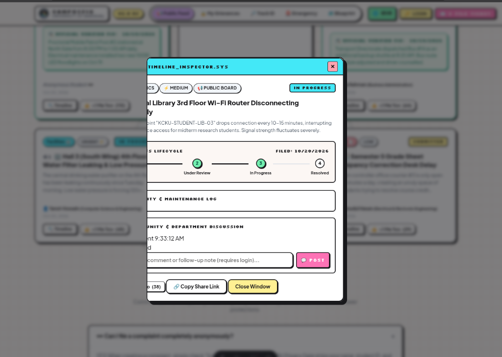
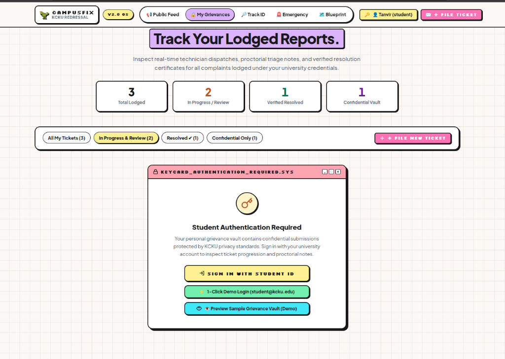
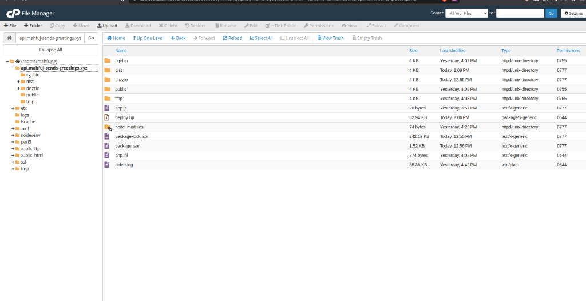
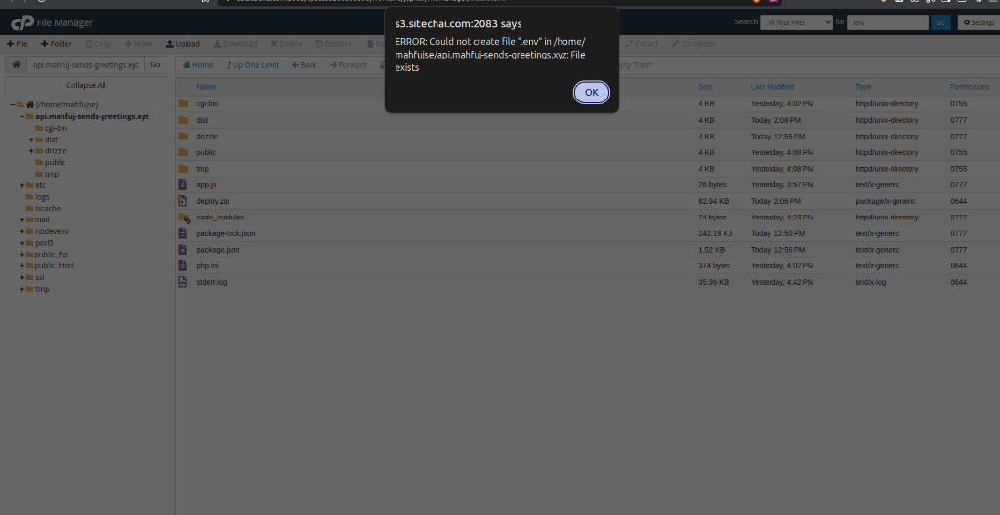
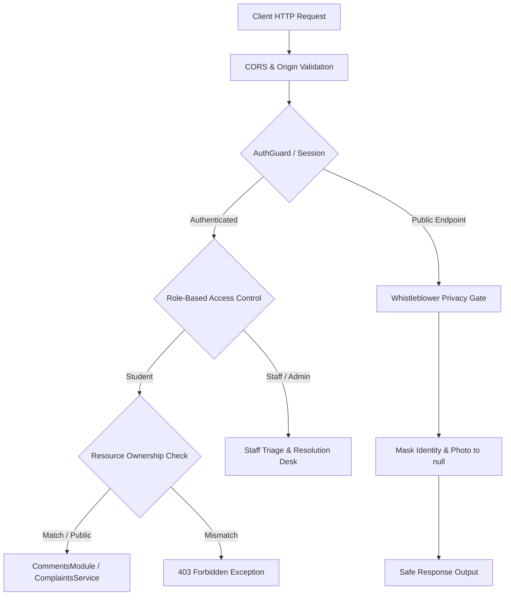

# ⚡ CampusFix — University of Barishal
> **Institution:** University of Barishal (বরিশাল বিশ্ববিদ্যালয় / BU)  
> **System:** Fullstack Campus Grievance, Whistleblower Protection & Student Welfare Portal  
> **Architecture:** NestJS 12 + Drizzle ORM + MySQL 8 + Better Auth 1.7 + Pure Astro 5 (Zero-JS Runtime Overhead)

[](https://nestjs.com/)
[](https://astro.build/)
[](https://www.mysql.com/)
[](https://orm.drizzle.team/)
[](https://better-auth.com/)
[](https://vitest.dev/)
[](https://github.com)

---

## 📸 UI/UX Showcase & Design System

CampusFix is crafted with a signature **Y2K Retro Neobrutalist design system**, blending tactile retro OS window chrome, pastel accent highlights, 1.5px/2px high-contrast solid borders, and hard-edge drop shadows with hyper-fast **zero-JavaScript** server-rendered HTML.

### 1. Live Public Notice Wall & Hero Radar
*Features category navigation pills, live "+1 Me Too" peer-endorsement upvote counters, verified author avatar badges, and anonymous whistleblower privacy masking.*



### 2. Real-Time Ticket Timeline Inspector
*Native browser `<dialog>` retro window inspector featuring a 4-stage visual lifecycle stepper (Submitted → Triage → Repair → Resolved), technician dispatch logs, and a community discussion feed with inline edit (✏️) and delete (🗑️) controls.*



### 3. Y2K Neobrutalist Component System
*Tactile card windows, high-contrast badges, custom status stamps, and pixel-aligned retro buttons.*

<p align="center">
  
  
</p>

---

## 🎨 Key UI/UX Highlights

- **Pure CSS Interactive Grid:** An ultra-lightweight, 100% GPU-accelerated interactive matrix background that responds smoothly to pointer movements without a single line of client-side JavaScript.
- **Zero-JS Runtime Overhead:** Built on Astro 5 static and server-rendered architecture — delivering sub-20ms first-contentful-paint (FCP) and optimal accessibility.
- **Browser-Native Modal System:** Clean, hardware-accelerated modals using HTML5 `<dialog>` and `.showModal()`, preventing bloated third-party JavaScript libraries.
- **Bi-Directional Localization (i18n):** Native support for both English and Bengali (বাংলা), including numeral conversion (`123` ⇄ `১২৩`) and localized time formatting.
- **Student Profile Avatars & Fallbacks:** High-resolution avatars with initial-letter badges and dedicated privacy silhouettes for whistleblowers.

---

## 📁 Repository Structure

```text
nestjs-astro/
├── backend/                       # 🛡️ NestJS REST API & MySQL Database
│   ├── src/
│   │   ├── auth/                  # Better Auth integration, Scrypt password hashing, RBAC guards
│   │   ├── comments/              # 💬 Dedicated CommentsModule (CRUD, IDOR protection, moderation)
│   │   │   ├── dto/               # CreateCommentDto, UpdateCommentDto
│   │   │   ├── comments.controller.ts # /comments and /complaints/:id/comments routes
│   │   │   ├── comments.service.ts    # Business logic, ownership checks, internal note filtering
│   │   │   └── comments.interface.ts  # Types & response contracts
│   │   ├── complaints/            # 🏢 ComplaintsModule (public wall, personal vault, upvotes)
│   │   ├── database/              # Drizzle ORM module, connection pool, schema definitions
│   │   │   ├── schema/            # Multi-file schema (auth, complaints, comments, upvotes)
│   │   │   └── seed.ts            # Idempotent database seeder with realistic student & faculty avatars
│   │   └── tickets/               # Legacy ticket module
│   ├── drizzle/                   # Auto-generated SQL migrations and seed.sql
│   ├── Hosting.md                 # cPanel Shared Hosting & Phusion Passenger deployment guide
│   ├── app.js                     # Phusion Passenger cPanel production entry point
│   ├── .env                       # Backend database configuration & secrets
│   └── package.json               # Backend dependencies (@nestjs, drizzle-orm, better-auth)
│
├── frontend/                      # 🚀 Pure Astro 5 Lightweight Frontend
│   ├── src/
│   │   ├── components/
│   │   │   ├── common/            # Navbar, Footer, MobileNav, PixelMatrixBackground
│   │   │   ├── feed/              # ComplaintCard, CategoryTabs, NoticeMarquee
│   │   │   ├── modals/            # ComplaintDetailModal, CreateComplaintModal, AuthModal
│   │   │   └── vault/             # VaultHero, VaultStatsBar
│   │   ├── layouts/               # Layout.astro (global state, auth modals, toast notifications)
│   │   ├── pages/
│   │   │   ├── index.astro        # Public Notice Board
│   │   │   ├── my-complaints.astro# Student Confidential Grievance Vault
│   │   │   ├── track.astro        # Real-time Ticket Radar & dossier scan
│   │   │   ├── emergency.astro    # University Emergency Protocol directory
│   │   │   └── architecture.astro # Interactive ERD & System Blueprint viewer
│   │   ├── services/              # API client methods and sample preview data
│   │   └── types/                 # TypeScript API contracts
│   └── package.json               # Astro dependencies
│
├── docs/                          # Screenshots, diagrams, and assets
├── templates/                     # Code review, feature planning, and deployment templates
├── ARCHITECTURE.md                # In-depth architectural specifications & Mermaid ERD
├── package.json                   # Monorepo root orchestration scripts
└── README.md                      # Project documentation
```

---

## 🚀 Quick Start (Local Development)

### 1. Prerequisites
- **Node.js:** `v20.x` or `v22.x` (LTS recommended)
- **MySQL:** `8.0+` or MariaDB `10.5+`
- **npm:** `v9+` or `v10+`

### 2. Clone and Install Dependencies

```bash
# Clone the repository
git clone https://github.com/your-username/nestjs-astro.git
cd nestjs-astro

# Install backend dependencies
cd backend && npm install

# Install frontend dependencies
cd ../frontend && npm install

# Return to root
cd ..
```

### 3. Environment Configuration

Create a `.env` file in the `backend/` folder:

```ini
PORT=3000
NODE_ENV=development

# MySQL Database Connection
DB_HOST=localhost
DB_PORT=3306
DB_USER=nest_user
DB_PASSWORD=nest1234
DB_NAME=nest_db

# Connection Pool Tuning
DB_CONNECTION_LIMIT=10
DB_MAX_IDLE=10
DB_IDLE_TIMEOUT=60000
DB_SSL=false

# Better Auth Secret
BETTER_AUTH_SECRET=53a2b70a970981ce5708a93d50cbbdfbf36818bc773ee03b81b572b9bc9df16a
BETTER_AUTH_URL=http://localhost:3000
TRUSTED_ORIGINS=http://localhost:3000,http://localhost:4321
```

### 4. Database Setup & Seeding

```bash
# Generate and push Drizzle ORM schema to MySQL
npm run db:push

# Seed the database with users, proctors, technicians, avatars, and test grievances
npm run db:seed
```

### 5. Start Development Servers

Run both services simultaneously from the root directory:

```bash
# Terminal 1: Start NestJS Backend API (Port 3000)
npm run dev:backend

# Terminal 2: Start Astro Frontend (Port 4321)
npm run dev:frontend
```

Open your browser and visit: **`http://localhost:4321`**

---

## 🔑 Default University Seed Accounts

All accounts are pre-configured with realistic names, departments, and avatars:

| Role | Name & Department | Email | Password |
| :--- | :--- | :--- | :--- |
| **Admin** | Dr. Rafiqul Islam (Chief Proctor) | `proctor@kcku.edu` | `admin123` |
| **Staff** | Kamal Uddin (Senior Maintenance Tech) | `technician@kcku.edu` | `tech1234` |
| **Staff** | Jashim Uddin (Transport Dispatcher) | `transport@kcku.edu` | `transport123` |
| **Student** | Tanvir Hossain (CSE Batch 21) | `student@kcku.edu` | `student123` |
| **Student** | Anika Rahman (BBA Batch 19) | `anika@kcku.edu` | `student123` |
| **Student** | Mahmudul Hasan (EEE Batch 22) | `mahmud@kcku.edu` | `student123` |

---

## 🛠️ Root Monorepo Commands

The root `package.json` provides centralized commands to manage both applications:

| Command | Action |
| :--- | :--- |
| `npm run dev:backend` | Starts the NestJS API with hot reload (`localhost:3000`) |
| `npm run dev:frontend` | Starts the Astro development server (`localhost:4321`) |
| `npm run build` | Builds both backend and frontend for production |
| `npm run build:backend` | Compiles NestJS backend via Nest CLI |
| `npm run build:frontend` | Compiles Astro static build to `frontend/dist/` |
| `npm run test:backend` | Executes all 68 Vitest backend unit test suites |
| `npm run lint:backend` | Runs backend lint checks |
| `npm run db:seed` | Seeds database with core users, complaints, and timeline records |
| `npm run db:push` | Directly synchronizes Drizzle schema with MySQL database |
| `npm run db:studio` | Launches visual Drizzle Studio web interface |
| `npm run zip:backend` | Bundles backend for cPanel deployment (`backend-deploy.zip`) |
| `npm run zip:frontend` | Bundles frontend static build for `public_html` (`frontend-dist.zip`) |
| `npm run zip:all` | Compiles and packages both deployment zip archives simultaneously |

---

## 🔒 Security, Trust & Privacy Architecture

CampusFix enforces rigorous multi-layered security controls designed specifically for academic institutions:



1. **Whistleblower Privacy Gate:** When a complaint is submitted with `isAnonymous: true`, the API strictly strips the student's name, user ID, department, and avatar photo, replacing them with anonymous identifiers before emitting public JSON.
2. **Insecure Direct Object Reference (IDOR) Protection:** Private grievances filed under confidential categories (such as dormitory ragging or safety concerns) are strictly inaccessible to other students. Only the original author and authorized staff/proctors can access the dossier.
3. **Dedicated `CommentsModule` with Resource Ownership:**
   - **Edit Control (`PATCH /comments/:id`):** Only the original comment author or system administrators can edit a comment.
   - **Delete Control (`DELETE /comments/:id`):** Permitted only for the comment author, maintenance staff, or proctors.
   - **Internal Departmental Notes:** Regular students cannot view or create `isInternalNote: true` entries; these are filtered automatically at the query level.
4. **Scrypt Cryptography:** Password hashing handled through Better Auth's scrypt cryptographic engine with secure salt generation.

---

## 📡 REST API Reference

### 🔐 Authentication (`/api/auth/*`)
- `POST /api/auth/sign-in/email` — Authenticate with email & password (sets secure sliding cookie)
- `POST /api/auth/sign-up/email` — Student registration with student ID, department, and avatar photo
- `POST /api/auth/sign-out` — Invalidate active session
- `GET /api/auth/get-session` — Retrieve current authenticated user profile

### 📢 Complaints (`/api/complaints/*`)
- `GET /api/complaints/public` — Browse public notice board (supports category, priority, and text search)
- `GET /api/complaints/my` — Access student's personal grievance vault (both public and private tickets)
- `GET /api/complaints/:id` — Inspect ticket dossier, dispatch timeline, and discussion comments
- `POST /api/complaints` — Submit a grievance with visibility and anonymity options
- `POST /api/complaints/:id/upvote` — Atomic "+1 Me Too" upvote toggle
- `PATCH /api/complaints/:id/status` — Staff & proctorial status resolution update

### 💬 Comments (`/api/comments/*` & `/api/complaints/:id/comments`)
- `GET /api/complaints/:complaintId/comments` — Retrieve discussion comments for a complaint
- `POST /api/complaints/:complaintId/comments` — Post a new community or staff comment
- `GET /api/comments/:id` — Fetch a single comment by ID
- `PATCH /api/comments/:id` — Edit an existing comment (author or admin only)
- `DELETE /api/comments/:id` — Delete a comment (author, staff, or admin only)

---

## 🧪 Testing & Quality Gates

The backend test suite is powered by **Vitest**, verifying authentication, role enforcement, IDOR prevention, and data mapping:

```bash
npm run test:backend
```

**Test Execution Summary (68/68 Passing):**
- `src/comments/comments.service.spec.ts` (16 tests) — Comment creation, ownership validation, IDOR checks, internal note filtering
- `src/comments/comments.controller.spec.ts` (4 tests) — Controller routing and parameter forwarding
- `src/complaints/complaints.service.spec.ts` (11 tests) — Public feed, privacy gate, upvote toggling, status updates
- `src/complaints/complaints.controller.spec.ts` (3 tests) — Complaints endpoint validation
- `src/auth/auth.service.spec.ts` (14 tests) — Better Auth session mapping, user registration, role assignments
- `src/auth/guards/auth.guard.spec.ts` (9 tests) — Session validation, Bearer token fallbacks, optional auth
- `src/auth/auth.controller.spec.ts` (2 tests) — Session controller endpoints
- `src/tickets/tickets.service.spec.ts` (9 tests) — Legacy ticket system compatibility

---

## 🌐 Production Deployment (cPanel & Ubuntu VPS)

CampusFix is engineered for seamless deployment across standard shared hosting environments (such as cPanel with LiteSpeed / Phusion Passenger) and dedicated cloud VPS setups:

- **Static Frontend:** Generated to `frontend/dist/` and ready for immediate deployment to `public_html` via standard CDN or Web Server.
- **Node.js API:** Configured with `backend/app.js` entry point for Phusion Passenger on cPanel.
- **Automated Packaging:** Running `npm run zip:all` automatically generates production-ready `backend-deploy.zip` and `frontend-dist.zip`.
- **Complete Step-by-Step Guide:** Refer to [`backend/Hosting.md`](backend/Hosting.md) for full cPanel database configuration, Phusion Passenger setup, and environment variables.

---

## 📄 License

This project is licensed under the [MIT License](LICENSE).  
Developed for **University of Barishal (বরিশাল বিশ্ববিদ্যালয়)** student community and administration.
